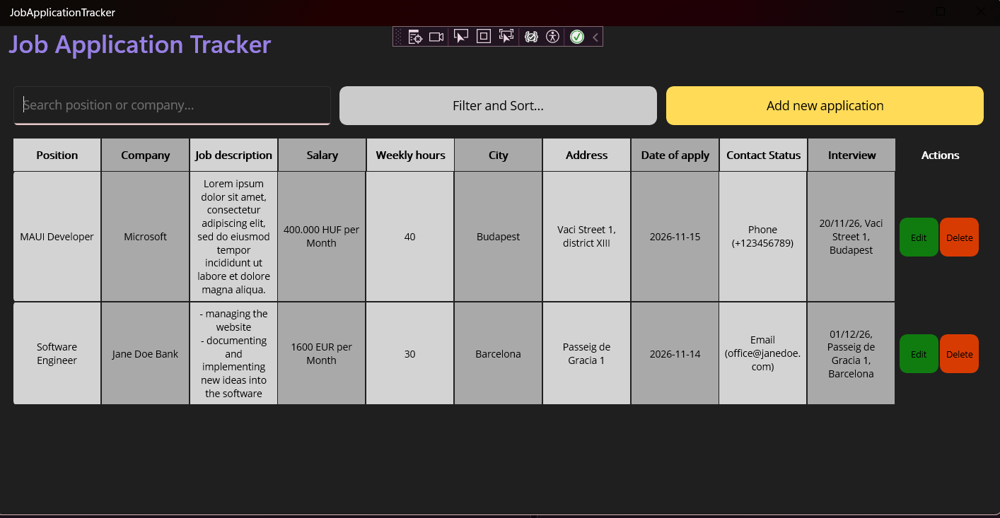
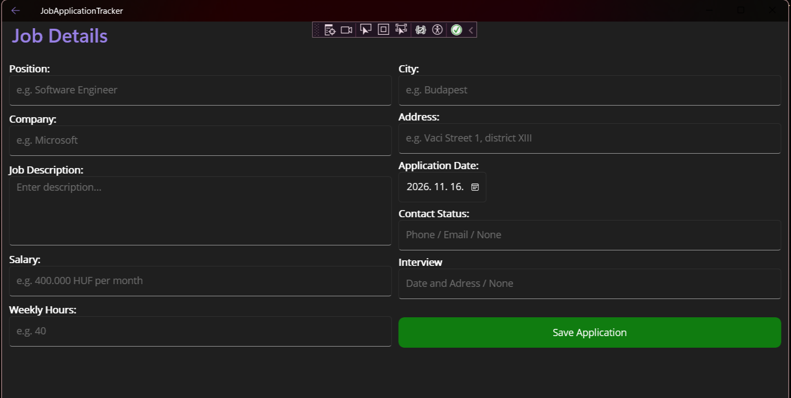
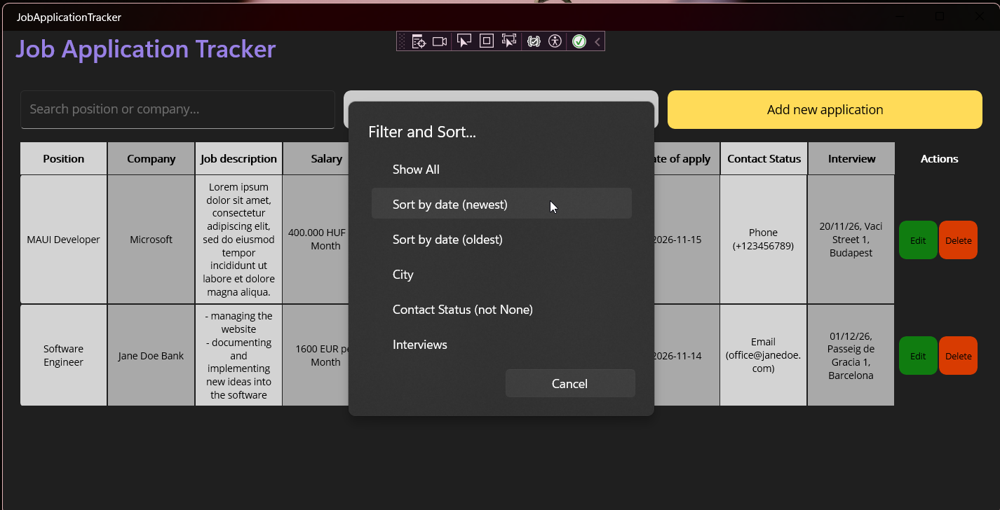
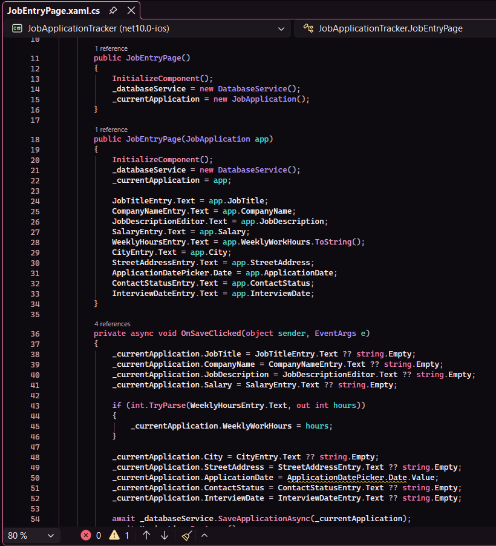

# Job Application Tracker
A .NET MAUI app to track job applications. It stores the data in a local SQLite database. Extra functions: search bar, filter/sort, edit and delete rows.



##  Key Features

- **CRUD Functions:** Add, view, edit, and delete job applications.
- **Local Storage:** Powered by SQLite for fast and offline data management.
- **Filtering and Sorting:**
  - Filter applications dynamically by city (from existing database entries).
  - Sort rows chronologically by application date or interviews.
- **User friendly UI:** Clean tabular layout built with CollectionView and separate window for adding or editing data.

## Architecture

- **Framework:** .NET MAUI
- **Language:** C# / XAML
- **Database:** SQLite (sqlite-net-pcl)
- **Platform Target:** Windows

### Prerequisites
- [.NET SDK](https://dotnet.microsoft.com/download) (with .NET MAUI workload installed)
- Visual Studio 2022 (or newer) with the **.NET Multi-platform App UI development** workload

### Installation
1. **Clone the repository:**
   ```
   git clone [https://github.com/nblanka-code/JobApplicationTracker.git](https://github.com/nblanka-code/JobApplicationTracker.git)
2. **Navigate to the project directory:**
   ```
   cd JobApplicationTracker
3. **Open the solution:** (JobApplicationTracker.sln in Visual Studio.)

# Job Entry Page:


# Filter and Sort:


# Job Entry Page - code behind:


**More screenshots can be found inside the screenshots folder.**
